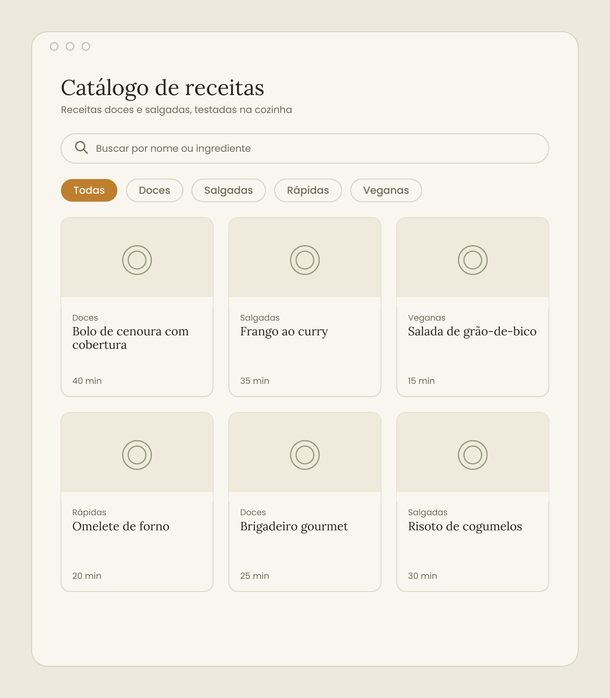
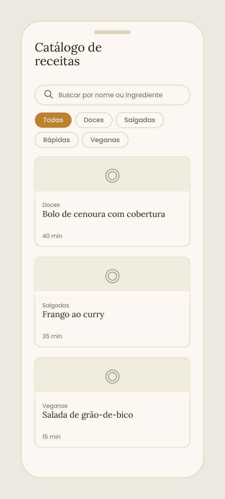

<div align="center">


# Catálogo de receitas

**Um caderno de receitas digital, com busca e filtros em tempo real.**

Feito com HTML, CSS e JavaScript puro, sem frameworks e sem back-end.


</div>

---

## 🍳 Sobre o projeto

O **Catálogo de receitas** reúne receitas doces e salgadas em uma interface leve e cuidadosa: uma grade de cards para explorar, busca por nome ou ingrediente e filtros por categoria para decidir rápido o que cozinhar.

É um projeto de portfólio front-end. O foco está no desenho da interface e nos fundamentos da web, sem bibliotecas por cima. Os dados ficam em um JSON local, então tudo roda direto no navegador.

## ✨ Funcionalidades

| Recurso | O que faz |
|---|---|
| 🔎 **Busca em tempo real** | Encontra receitas por nome ou ingrediente enquanto você digita |
| 🏷️ **Filtro por categoria** | Doces, Salgadas, Rápidas e Veganas |
| 🍽️ **Detalhes em modal** | Ingredientes e modo de preparo, sem sair da página |
| 📱 **Layout responsivo** | Grade de três colunas no desktop e coluna única no mobile |
| 🌿 **Sem back-end** | Receitas em um JSON local, sem chamadas de API |

## 🖼️ Prévia do layout

> [!NOTE]
> As imagens abaixo são mockups do [guia visual](docs/catalogo-de-receitas-guia-visual.pdf), não capturas do site pronto. A construção do código é a próxima etapa.

<p align="center">
  
  &nbsp;&nbsp;&nbsp;
  
</p>

## 🎨 Design

A identidade visual nasce da cozinha: tons de **ervas e especiarias** sobre uma base neutra e quente, com um toque editorial de caderno de receitas nos títulos. O guia completo, com tipografia, cores, layouts e animações, está em [`docs/catalogo-de-receitas-guia-visual.pdf`](docs/catalogo-de-receitas-guia-visual.pdf).

### Paleta

| Cor | Uso |
|---|---|
|  | Fundo da página |
|  | Superfície dos cards |
|  | Texto principal |
|  | Texto secundário |
|  | Cor primária (verde-oliva) |
|  | Destaque, como o filtro ativo |
|  | Linhas e divisórias |

### Tipografia

| Fonte | Uso |
|---|---|
| [**Lora**](https://fonts.google.com/specimen/Lora) | Títulos e nomes das receitas |
| [**Poppins**](https://fonts.google.com/specimen/Poppins) | Textos, busca, filtros e informações secundárias |

Ambas são gratuitas e estão disponíveis no Google Fonts.

### Animações e efeitos

<details>
<summary>Ver todas as interações</summary>

<br>

| Interação | Efeito |
|---|---|
| Passar o mouse no card | Sobe cerca de 3 px e a borda muda para verde-oliva (150 ms, sem sombra) |
| Filtro por categoria | O chip ativo ganha a cor de destaque e a grade se reorganiza com fade de 200 ms |
| Busca | Os cards que não correspondem somem com um fade rápido, sem empurrar os demais bruscamente |
| Abrir uma receita | O modal entra com fade e um leve aumento de escala, de 96% a 100% |
| Carregamento da página | Os cards aparecem em fade escalonado, com cerca de 40 ms entre cada um |

Só o carregamento inicial se move sem ação da pessoa. Todo o resto responde a um hover, a um clique ou à digitação.

</details>

## 🛠️ Tecnologias

| Tecnologia | Papel no projeto |
|---|---|
| **HTML5** | Estrutura da página, dos cards e do modal |
| **CSS3** | Identidade visual, layout responsivo e animações |
| **JavaScript (vanilla)** | Busca, filtro por categoria e abertura do modal |
| **JSON** | Base local com as receitas |

## 🗺️ Roadmap

- [x] Escolha do tema, da stack e do escopo
- [x] Guia visual com tipografia, paleta, layouts desktop e mobile e animações
- [ ] Estrutura HTML e base de receitas em JSON
- [ ] Estilos e layout responsivo
- [ ] Busca e filtro por categoria
- [ ] Modal com os detalhes da receita
- [ ] Animações e refinamentos
- [ ] Fotos reais das receitas
- [ ] Publicação online

## 📁 Estrutura sugerida

<details>
<summary>Ver pastas e arquivos</summary>

```text
catalogo-de-receitas/
├── index.html
├── css/
│   └── style.css
├── js/
│   └── script.js
├── data/
│   └── receitas.json
├── assets/
│   └── imagens/
│       ├── favicon.svg
│       ├── folha.svg
│       └── receitas/
└── docs/
    ├── catalogo-de-receitas-guia-visual.pdf
    ├── preview-desktop.png
    └── preview-mobile.png
```

</details>

## 🚀 Como rodar

Não há dependências nem etapa de build. Com o código pronto, basta abrir o `index.html` no navegador. Durante o desenvolvimento, a extensão **Live Server** do VS Code recarrega a página a cada alteração.

---

<div align="center">

Feito por **Gabriel** como projeto de portfólio front-end.

</div>
